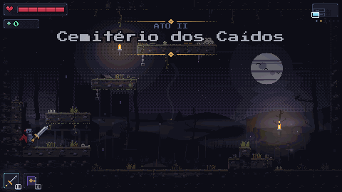

# Ruínas Esquecidas

Roguelite 2D de ação lateral em fantasia sombria. Você controla o Último Vigia, que desce os andares de uma fortaleza em ruínas, enfrentando o que restou de seus habitantes.

Dead Cells, Skul, Astral Ascent, Have a Nice Death, Blasphemous e Hollow Knight servem apenas como referência de design. Nenhum código, arte ou conteúdo foi copiado.

## Status

- [x] 1. Setup e movimento
- [x] 2. Combate básico
- [x] 3. Inimigos (Carniçal, Arqueiro Oco, Vulto e Cão de Ossos; o chefe vem na etapa 5)
- [x] 4. Relíquias
- [x] 5. Salas procedurais (fortaleza em 3 biomas, minimapa e o chefe Guardião Partido)
- [x] 6. Progressão permanente (almas, Santuário e árvore de melhorias salva no navegador)
- [x] 7. Polimento e deploy (áudio sintetizado, título, pausa, opções e build pronto para publicar)

## Prints e GIFs

<!-- Adicionar prints e GIFs em docs/ e referenciar aqui, por exemplo:  -->

## Como rodar

Requer Node 22.13 ou superior.

```bash
npm install        # instala as dependências
npm run dev        # servidor de desenvolvimento
npm test           # testes (Vitest)
npm run lint       # ESLint
npm run typecheck  # checagem de tipos
npm run build      # build de produção
```

## Controles

| Ação            | Teclado      | Controle                         |
| --------------- | ------------ | -------------------------------- |
| Andar           | Setas ou A/D | Analógico esquerdo ou direcional |
| Pular           | Espaço ou W  | Botão A (índice 0)               |
| Rolar           | L ou Shift   | Botão B (índice 1) ou RB         |
| Atacar          | J            | Botão X (índice 2)               |
| Especial        | K            | Botão Y (índice 3)               |
| Trocar relíquia | Q            | LB (índice 4)                    |
| Relíquia 1 / 2  | 1 / 2        | —                                |
| Pegar do chão   | E            | RT (índice 7)                    |
| Pausa           | Esc ou P     | Start (índice 9)                 |
| Som liga/mudo   | M            | —                                |

## Combate (etapa 2)

- **Ataque** em três fases (preparação, golpe ativo, recuperação), com hitbox e knockback. Rolar cancela a recuperação.
- **Esquiva perfeita:** rolar até 150 ms antes de um golpe acertar dá câmera lenta, um anel de luz e dobra o dano do seu próximo ataque. A janela fica em `src/data/combat.ts`.
- **Fluidez:** os apertos de ataque, especial e rolagem feitos até 120 ms antes de poder agir ficam guardados (_input buffer_) e valem assim que der. A rolagem cancela a preparação e a recuperação do golpe; o próximo golpe do combo entra por cima da metade final da recuperação; dá para virar durante a preparação e a recuperação; e os golpes corpo a corpo dão um passo à frente. Valores em `src/data/combat.ts`.
- **Peso do golpe:** o congelamento, o tremor e as faíscas crescem com o dano (golpe leve da adaga ≈ 30 ms; martelo ≈ 80 ms; golpe dobrado da esquiva ≈ 155 ms). Ver `HIT_WEIGHT` em `src/data/fx.ts`.
- **Sensação de impacto:** hit stop, tremor de câmera, faíscas, números de dano e arco do golpe. Todos os valores ficam em `src/data/fx.ts`.
- Ao morrer, a tela "Você caiu" leva o herói a acordar no santuário (J, Espaço ou botão A/X do controle), de onde começa uma nova descida.

## Atmosfera e direção de arte (pixel art em código)

Cada bioma tem o seu clima, definido em `src/data/biomeLook.ts` (rampas de cor da pedra, céu, musgo, luz e névoa):

- **Muralhas e Pátio:** noite de luar, céu em degradê com _dithering_, lua com crateras, fortaleza em ruínas ao longe, arcadas góticas com janelas e trepadeiras.
- **Salões e Capela:** salão de pedra roxa com vitrais acesos, feixes de luz, colunas, estandartes e cortinas de veludo.
- **Catacumbas e Masmorra:** pedra úmida esverdeada, nichos de caveiras, raízes, correntes e lanternas de alma.
- **Floresta Apodrecida:** céu doente com sol pálido, árvores mortas em silhueta, troncos grossos com raízes e buracos que brilham, vaga-lumes.
- **Pântano dos Afogados:** céu cinzento, água escura com reflexos, palafitas e troncos tortos, musgo pendurado e fogos-fátuos azulados.
- **Cemitério dos Caídos:** noite fria de lua baixa, o castelo em ruínas sobre uma colina, lápides, cruzes e cercas de ferro, um mausoléu, lanças com estandartes rasgados e almas lilases.
- **Minas Desabadas:** subterrâneo de rocha marrom e escuridão quase total, escoras de madeira, trilhos, lampiões âmbar, cristais que brilham e estalactites.
- **Vila Queimada:** céu de fumaça avermelhado pelo incêndio, casas e uma igreja de torre quebrada em silhueta, esqueletos de casas com vigas à mostra, chamas vivas, cinzas e brasas no ar.

Cada fundo tem três planos com parallax (distante, médio e primeiro plano). Os blocos de pedra mudam conforme os lados que ficam ao ar livre (quinas iluminadas, bases sombreadas) e a decoração do cenário (tufos, ossos, pedregulho, trepadeiras, correntes, estalactites, teias e rachaduras) é sorteada por sala com a semente da run (`src/logic/decor.ts`). A escuridão é da cor de cada bioma e é "apagada" por luzes de verdade: tochas, fogueiras, a porta e o baú também iluminam. Os personagens têm sombra no chão e a barra de vida tem moldura, rastro de dano e pulso com pouca vida.

Os desenhos ficam em `src/systems/biomeBackgrounds.ts`, `tileArt.ts`, `decorArt.ts` e `environmentTextures.ts`; para usar arte final basta carregar imagens com as mesmas chaves.

**Nitidez:** o jogo usa escala inteira _em pixels do monitor_, não do CSS. Com a escala do Windows em 125% ou 150%, um zoom inteiro em pixels CSS vira fracionário no monitor e alguns pixels ficam maiores que outros (borrão e tremida); aqui o zoom é calculado em pixels reais (`src/utils/zoom.ts`).

## Interface (HUD)

Toda a interface usa o mesmo estilo de painéis de pedra e ferro (`src/systems/hudArt.ts`) e a fonte de pixels (`src/systems/pixelFont.ts`). Os valores ficam em `src/data/ui.ts`.

- **Vida:** painel compacto no canto superior esquerdo com o coração, a barra com marcas e brilho e um rastro claro que mostra o tamanho do dano; com pouca vida a barra pulsa.
- **Relíquias:** duas casas no canto inferior esquerdo. A ativa tem moldura na cor da relíquia, brilho e a tecla do especial (K); a outra fica apagada com a tecla de troca (Q). A recarga sobe como uma cortina e a casa pisca quando o especial volta.
- **Minimapa:** painel no canto superior direito com as salas em relevo, a sala atual pulsando e três losangos que mostram em qual bioma você está.
- **Chefe:** painel no pé da tela com o nome, a barra com um traço onde começa a fase 2 e o rastro do último golpe.
- **Dica de controles:** teclas desenhadas como teclas (com letras de 3x5 pixels), na primeira sala, sumindo sozinhas.
- **Nome do bioma ("ATO I"), números de dano e telas** de morte, vitória e escolha de relíquia também usam a fonte de pixels.

## O Último Vigia (pixel art em código)

O herói é desenhado quadro a quadro em código: elmo com a viseira acesa, armadura cinza-azulada, capa e penacho rasgados, com contorno automático de 1 px. Um esqueleto simples (ombros, mãos, joelhos, pés) calculado em `src/logic/heroPose.ts` posiciona as partes em cada pose de `src/data/hero.ts`, e `src/logic/heroAnim.ts` escolhe a animação pelo estado (parado, correndo, pulando, caindo, rolando, preparando/golpeando/recuperando, ferido, morto). A arma da relíquia aparece na mão e gira com o golpe; o Tomo flutua ao lado. Poeira sobe ao pousar e ao rolar.

## Relíquias (etapa 4)

Existem **9 relíquias**; o jogador carrega **duas** e alterna entre elas com **Q**. Cada uma define o ataque básico, um **especial com recarga** (K) e um **bônus passivo** (vale enquanto ela está ativa). Os dados ficam em `src/data/relics.ts`.

| Relíquia          | Básico                   | Especial                            | Passiva                       |
| ----------------- | ------------------------ | ----------------------------------- | ----------------------------- |
| Lâmina do Vigia   | Combo de 3 golpes        | Investida que atravessa inimigos    | +12% de velocidade            |
| Martelo Sepulcral | Lento, muito knockback   | Impacto no chão que atordoa em área | -20% de dano recebido         |
| Foice da Névoa    | Alcance longo e rápido   | Rouba vida dos inimigos atingidos   | +15% de dano                  |
| Tomo Cinzento     | Raio à distância         | Barreira que bloqueia flechas       | -20% de recarga dos especiais |
| Adaga Sombria     | Combo rápido de 4 golpes | Investida curta e veloz             | +18% de velocidade            |
| Lança Vigilante   | Estocada de longe        | Arremetida que perfura              | -10% de dano recebido         |
| Machado Rachador  | Dois golpes pesados      | Giro que acerta em volta            | +25% de dano                  |
| Arco de Osso      | Flecha rápida de longe   | Flecha pesada que atordoa           | +10% de dano                  |
| Mangual Cinéreo   | Golpe e giro em volta    | Rodopio que empurra                 | -25% de recarga dos especiais |

- **Golpe de troca:** trocar de relíquia até 0,7 s depois de acertar um inimigo dispara um golpe curto em área (cada acerto vale um golpe de troca).
- **Novas relíquias** caem de inimigos derrotados e ficam **no chão, deitadas**, como a arma de verdade. Chegue perto, aperte **E** (ou RT) e escolha qual das duas descartar (**J** ou as teclas **1**, **2** e **3**; a 3 deixa no chão). As teclas **1** e **2** também trocam direto de relíquia em jogo. A relíquia largada por um inimigo **some depois de 14 s** (pisca nos últimos 4 s); as de baús e do chefe esperam para sempre. Os baús das salas de tesouro sempre soltam uma relíquia (ou curam, se não houver nenhuma nova).

## Inimigos (etapa 3)

Cada inimigo tem uma IA por **máquina de estados** pura (`src/logic/ai`), que só recebe o que ele "percebe" e devolve o que quer fazer. A entidade Phaser traduz isso em movimento. Piscar em laranja = golpe chegando: dá tempo de rolar.

| Inimigo                     | Comportamento                                                                                                                                                                                                                                                 |
| --------------------------- | ------------------------------------------------------------------------------------------------------------------------------------------------------------------------------------------------------------------------------------------------------------- |
| Carniçal                    | Patrulha, avança quando vê o jogador e golpeia de perto                                                                                                                                                                                                       |
| Arqueiro Oco                | Mantém distância, mira (telegrafia) e atira flechas                                                                                                                                                                                                           |
| Vulto                       | Flutua, atravessa plataformas e ataca em mergulho                                                                                                                                                                                                             |
| Cão de Ossos                | Rápido, dá botes; em bando, os ataques são escalonados                                                                                                                                                                                                        |
| Lobo Espectral (Floresta)   | O cão da floresta: mais rápido e mais forte; corre no mesmo bando dos cães                                                                                                                                                                                    |
| Raiz Emboscadora (Floresta) | Estacionária: dorme como um monte de raízes (não pode ser acertada), acorda quando o herói chega perto, chicoteia de longe e afunda de volta                                                                                                                  |
| Sapo Peçonhento (Pântano)   | Pula para manter a distância e cospe veneno em arco depois de inchar a papada (a telegrafia)                                                                                                                                                                  |
| Fogo-Fátuo (Pântano)        | Chama azulada que paira sobre o charco e mergulha depois de esquentar; ilumina a sala em volta                                                                                                                                                                |
| Soldado Caído (Cemitério)   | Marcha com o escudo na frente: golpes de frente são bloqueados. A guarda só cai quando ele estoca (telegrafia longa) e demora a virar se você passa por trás: o desenho dele continua olhando para o lado antigo até a guarda virar, e é aí que o golpe entra |
| Necromante (Cemitério)      | Mantém distância e, depois de erguer o cajado (telegrafia), solta três orbes em leque; frágil se alcançado                                                                                                                                                    |
| Golem de Pedra (Minas)      | Lento e quase imóvel ao ser atingido; ergue os braços (as rachaduras acendem) e bate no chão com uma onda em volta de si                                                                                                                                      |
| Morcego de Cristal (Minas)  | Rápido e nervoso, dobra as asas e mergulha; os cristais nas costas iluminam a sala. Bate nas paredes e só enxerga o herói em linha reta de ar livre (a rocha o esconde)                                                                                       |
| Aldeão em Chamas (Vila)     | Morador em pânico, tomado pelo fogo: corre muito rápido e se agarra num bote longo, depois de um aviso curto. Frágil; a chama ilumina a sala                                                                                                                  |
| Corvo Carniceiro (Vila)     | Espera de lado e no alto e cruza a sala em rasante na altura do herói, passando por ele e seguindo adiante; a rocha ou a parede o escondem                                                                                                                    |

Os inimigos e o chefe são **pixel art desenhada em código**, quadro a quadro, como o herói: cada um tem a sua silhueta (o Carniçal encurvado de trapos vermelhos, o Arqueiro Oco encapuzado com arco de osso, o Vulto de fiapos roxos, o Cão de Ossos de costelas à mostra, o Guardião de armadura rachada) e animações de parado, andando, preparando o golpe, golpeando, recuperando, ferido e morrendo. As poses ficam em `src/data/enemySprites.ts`, o desenho em `src/systems/enemySprites.ts` e a escolha da animação em `src/logic/enemyAnim.ts`. Ao morrer, o corpo cai, fica um instante no chão e some.

Flechas também podem ser esquivadas com a esquiva perfeita. Inimigos derrotados não renascem na mesma sala; os valores de cada um ficam em `src/data/enemies.ts`.

## A fortaleza (etapa 5)

Uma run atravessa **6 áreas** (escolhidas entre 8) do reino em ruínas, cada uma um mapa interligado de salas gerado por semente. O herói não entra direto no castelo: começa por uma área ao ar livre, escolhida em uma passagem do santuário (a **Floresta Apodrecida** ou o **Pântano dos Afogados**), cruza o **Cemitério dos Caídos** (um campo de batalha com o castelo se erguendo ao longe) ou as **Minas Desabadas** (um novo caminho a escolher), passa pela **Vila Queimada**, chega às **Muralhas e Pátio** (a entrada do castelo), atravessa os **Salões e Capela** e termina nas **Catacumbas e Masmorra**, com o chefe. Cada mapa tem sala inicial, salas de combate, uma fogueira de descanso, um baú e uma **porta de saída** para o bioma seguinte; o último termina na arena do chefe.

- **Salas:** desenhos em texto (`src/data/templates`), em células de 30x17 blocos, com portas nas quatro direções. Antes de entrar no jogo, todo desenho é validado: as portas se alcançam com os pulos do herói e nada fica fora de alcance (`src/logic/map`).
- **Geração:** `generateBiomeMap` monta o grafo de salas numa grade, com ligações extras para criar voltas, e sorteia os desenhos pela semente. A mesma semente dá a mesma run.
- **Viagem:** as portas abertas levam à sala vizinha; as sem ligação são fechadas por parede. O minimapa (canto da tela) mostra as salas visitadas e as vizinhas; as salas secretas (liberadas na árvore com _Passagens_) só aparecem depois de visitadas.
- **Jornada em etapas:** a run segue o plano `RUN_PLAN` (`src/data/mapRules.ts`): uma lista de etapas, cada uma com as áreas que o jogador pode escolher ao chegar nela. Com uma área só, o santuário tem uma passagem; com duas, tem duas (um de cada lado da sala, cada um com a cor e o nome da área de destino) e o herói escolhe o caminho. Uma área não se repete na mesma run. Hoje a primeira etapa oferece Floresta ou Pântano, a segunda, Cemitério ou Minas, a terceira, a Vila Queimada, e as áreas de fora vêm todas antes do castelo; acrescentar áreas e caminhos é preencher dados (os testes conferem que a etapa final só oferece áreas com sala de chefe e as outras, com sala de saída).
- **Fogueira:** cura tudo uma vez. **Baú:** solta uma relíquia. **Porta de saída:** abre o próximo bioma.
- **Guardião Partido:** o chefe também **pula**: salta o obstáculo que o barra, sobe com um pulo alto até quem está num balcão e dá um salto comprido quando você está longe (poeira e tremor ao pousar; valores em `src/data/boss.ts`). Ele tem três ataques (pancada, investida e tremor) e entra numa fase 2 mais agressiva com metade da vida. Ao cair, solta uma relíquia e a tela de vitória aparece. Dados em `src/data/boss.ts`, IA em `src/logic/ai/boss.ts`.
- Cada bioma tem a sua escuridão e névoa (`BIOME_DARKNESS`).

## Alas e mobília

Cada área é dividida em **alas**, com ambientes e mobília próprios (`src/data/wings.ts`):

| Área       | Alas                                                                                                                                |
| ---------- | ----------------------------------------------------------------------------------------------------------------------------------- |
| Muralhas   | Pátio de Armas (barris, caixotes, bonecos de treino, armas), Celeiros e Estábulos (carroças, barris)                                |
| Salões     | Salão do Trono (mesas, cadeiras, lustres, tapeçarias), Biblioteca (estantes, livros), Capela (bancos, altar, candelabros)           |
| Catacumbas | Ossuário (caveiras, caixões), Masmorra (celas, gaiolas), Cripta Real (sarcófagos, altar, urnas)                                     |
| Floresta   | Bosque Morto (troncos caídos, tocos, cogumelos, fogueira abandonada), Túnel de Raízes (raízes penduradas, casulos, lanternas)       |
| Pântano    | Charco dos Afogados (juncos, estacas, barcos virados, cogumelos), Vila de Palafitas (barris, caixotes, redes de pesca, lanternas)   |
| Cemitério  | Jazigos Esquecidos (lápides, covas, urnas, caveiras, lampiões), Campo de Batalha (armas fincadas, estandartes, carroças, fogueiras) |
| Minas      | Galeria de Extração (vagonetes, picaretas, escombros, lampiões), Gruta de Cristais (cristais, estalactites, escombros, cogumelos)   |
| Vila       | Casas em Cinzas (paredes em ruína, mesas, cadeiras, barris, vigas queimadas), Praça da Forca (poços, forcas, carroças, fogueiras)   |

- **Como as alas se distribuem:** as salas do mapa ficam em faixas da esquerda para a direita (`src/logic/wings.ts`), então atravessar a área é atravessar ambientes diferentes; a ordem das alas muda a cada run, e o nome da ala aparece ao entrar nela.
- **Mobília:** `src/logic/furniture.ts` escolhe, de forma determinística por sala, onde cada peça cabe (no chão, sobre um apoio e com espaço livre acima; ou pendurada no teto), sem tapar portas, inimigos, objetos nem o ponto de nascimento, e sem uma peça por cima da outra. A decoração miúda (tufos, ossos, teias) desvia da mobília. O desenho é pixel art de código (`src/systems/furnitureArt.ts`) com as cores de cada área, e as peças com chama (velas, candelabros, lustres) iluminam a sala.
- **Para criar uma ala nova:** acrescente uma entrada em `WINGS` com o nome e a lista de peças; os testes conferem nomes, pesos e que toda peça cabe em algum modelo de sala.

## Progressão permanente (etapa 6)

Cada run rende **almas**, e o **Santuário** — uma sala própria, toda voltada para um anjo caído colossal esculpido na parede do fundo, com um altar aos seus pés, que o herói atravessa ao passar de um bioma para o outro e onde acorda depois de morrer ou vencer — troca almas por melhorias permanentes numa árvore de 10 nós, seguindo o modelo do documento de design (20% atributos básicos, 40% agência e consistência, 40% expansão de conteúdo).

- **Almas:** cada inimigo derrotado rende almas (o chefe rende bastante) e elas ficam **carregadas** (contador sob a barra de vida). Só são **guardadas** ao passar para o próximo bioma ou ao vencer o chefe (que ainda dá um prêmio). Se o herói morre, as não guardadas **se perdem**, exceto a fração que a **Retenção** protege.
- **Árvore:** _Vigor_ e _Força_ (atributos, com teto de +50% de vida e +25% de dano); _Retenção_, _Sorte_, _Colheita_ e _Reflexo_ (agência, até +30 ms na esquiva perfeita); _Arsenal I e II_ (liberam as 5 armas novas), _Passagens_ (uma sala secreta por bioma) e _Mestre_ (escolher a relíquia inicial). Os pré-requisitos são respeitados e o custo do nível _n_ é `custoBase × multiplicador^(n−1)`, com multiplicador entre 1,15 e 1,35. Tudo em `src/data/meta.ts`.
- **Jogo base vencível sem upgrades:** com o save zerado os efeitos são neutros (4 armas originais, nenhuma sala secreta, nenhum bônus), e os tetos garantem que a árvore nunca passa de 1,5x a 2x dos atributos iniciais (há testes para isso).
- **Save:** `localStorage` do navegador, versionado e validado ao carregar (save corrompido ou editado nunca derruba o jogo; níveis acima do máximo, nós desconhecidos e pré-requisitos faltando são corrigidos). A gravação é em etapas, com cópia de segurança, para uma queda no meio não corromper o progresso. Se o navegador não permitir `localStorage`, o jogo continua com o progresso só daquela sessão. Lógica em `src/logic/meta`.
- **Controles do Santuário:** **E** (ou RT) diante do altar abre a janela de melhorias, que também guarda as almas carregadas. A sala veste o bioma (pedra, fundo, luz e a cor do fogo, dos estandartes e das runas), tem o anjo colossal sob um feixe de luz, colunas, braseiros e velas, e uma passagem em arco de pedra à direita, aberta para a paisagem da região de destino e com uma placa de madeira com o nome do lugar, que leva adiante. Na janela de melhorias, setas ou WASD escolhem, **J** compra e **E** ou Esc fecha. As melhorias valem na hora, mas _Passagens_ e a relíquia inicial só mudam a próxima run.

## Título, pausa e opções (etapa 7)

- **Tela de título:** o anjo colossal ao fundo, o nome do jogo e o menu: _Jogar_, _Opções_ (música, efeitos e liga/mudo), _Controles_ e _Zerar progresso_ (pede confirmação, com "Não" já selecionado, e apaga o save e as cópias). Mostra as almas guardadas, as descidas e as vitórias.
- **Pausa:** Esc, P ou Start abre o menu sobre o jogo parado: continuar, ajustar o som, ver os controles ou _desistir da descida_ (com confirmação; conta como run perdida e as almas carregadas se perdem, menos a parte que a Retenção protege).
- **Menus com teclado e controle:** o mesmo leitor de botões (`src/systems/MenuInput.ts`) e a mesma lista de linhas (`MenuList.ts`) servem ao título e à pausa. Textos e medidas em `src/data/ui.ts`.

## Áudio (etapa 7)

Todo o som é **sintetizado por WebAudio**, sem nenhum arquivo de áudio.

- **Efeitos:** cada som é uma _receita_ em `src/data/audio.ts` (osciladores que deslizam de uma frequência a outra e ruído filtrado, com envelope), tocada por `src/systems/AudioSystem.ts`: golpes, impactos, dano, rolagem, esquiva perfeita, pulo e pouso, almas, cura, relíquias, baú, fogueira, altar, passagem, chefe, interface, morte e vitória. Um intervalo mínimo por som evita estourar com golpes em série.
- **Trilha:** gerada compasso a compasso (`src/logic/audio/music.ts`, lógica pura e determinística, com testes): acordes lentos, baixo e uma melodia esparsa com eco. Cada bioma tem a sua escala e andamento (menor natural, menor harmônico, frígio), e há trilhas próprias para o título, o santuário e o chefe. Ao mudar de sala a trilha só troca se for outra.
- **Volume:** música, efeitos e liga/mudo nas opções e na pausa; **M** liga e desliga o som em qualquer tela. As escolhas ficam salvas no navegador (`src/logic/audio/settings.ts`, validadas ao carregar).
- O navegador só libera áudio depois de um clique ou tecla, então o som começa no primeiro aperto de botão; a aba escondida suspende o áudio.

## Publicar o jogo (build)

```bash
npm run build      # confere os tipos e gera a pasta dist/
npm run preview    # abre o build de produção para testar
```

A pasta `dist/` é o jogo inteiro (HTML, JavaScript e a fonte), com caminhos relativos (`base: './'` em `vite.config.ts`), então funciona em qualquer hospedagem estática, na raiz ou numa subpasta:

- **itch.io:** compacte o _conteúdo_ de `dist/` num `.zip` (o `index.html` fica na raiz do zip), crie um projeto do tipo _HTML_ e marque "This file will be played in the browser".
- **GitHub Pages, Vercel ou Netlify:** publique a pasta `dist/` (ou rode o build no serviço com o comando `npm run build` e a saída `dist`).
- Abrir o `index.html` direto do disco (`file://`) não funciona, porque os navegadores bloqueiam módulos de arquivo local; use `npm run preview` ou uma hospedagem.
- O progresso (almas, melhorias, volume) fica no `localStorage` do navegador, separado por endereço: mudar de domínio começa um save novo.

## Decisões técnicas

- **Phaser 3 + Arcade Physics** para renderização e colisões.
- **TypeScript em modo `strict`.**
- **Lógica pura separada da camada Phaser:** `src/logic` não importa Phaser e é coberta por testes com Vitest; a camada Phaser apenas chama essas funções.
- **Dados em `src/data`:** balanceamento e conteúdo (relíquias, inimigos, salas) fora do código de lógica.
- **Resolução 480x270 com escala inteira**, para manter o pixel art nítido.
- **Coyote time e jump buffer** para um pulo mais tolerante e responsivo.
- **Sem alocação no `update`:** objetos pré-alocados e reutilizados para evitar pausas do coletor de lixo.
- **Arte e som criados em código:** nenhum arquivo de arte ou áudio externo; o único asset de terceiros é a fonte.
- **Fonte pixel (Press Start 2P, OFL) em bitmap:** os glifos são desenhados uma vez num atlas, sem meios-tons e com contorno escuro de 1 px já no desenho, e viram uma fonte de bitmap do Phaser. O texto fica nítido em qualquer escala inteira (o texto comum de canvas borrava nas bordas e no contorno).

## Estrutura de pastas

```text
src/
  logic/     lógica pura, sem Phaser
  data/      balanceamento e conteúdo
  scenes/    cenas do Phaser
  entities/  jogador, inimigos e afins
  systems/   sistemas que ligam a lógica ao Phaser
tests/       testes da lógica
docs/        prints e GIFs
```

## Licenças

- Código: licença MIT.
- Assets (gráficos e sons): veja [ASSETS-LICENSES.md](ASSETS-LICENSES.md).

```text
MIT License

Copyright (c) <ano 2026> <seu nome>
```
